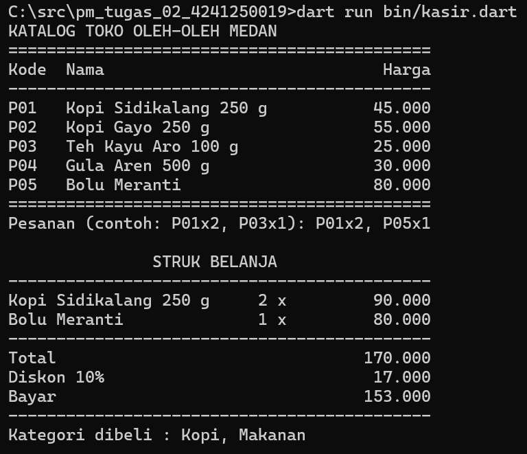
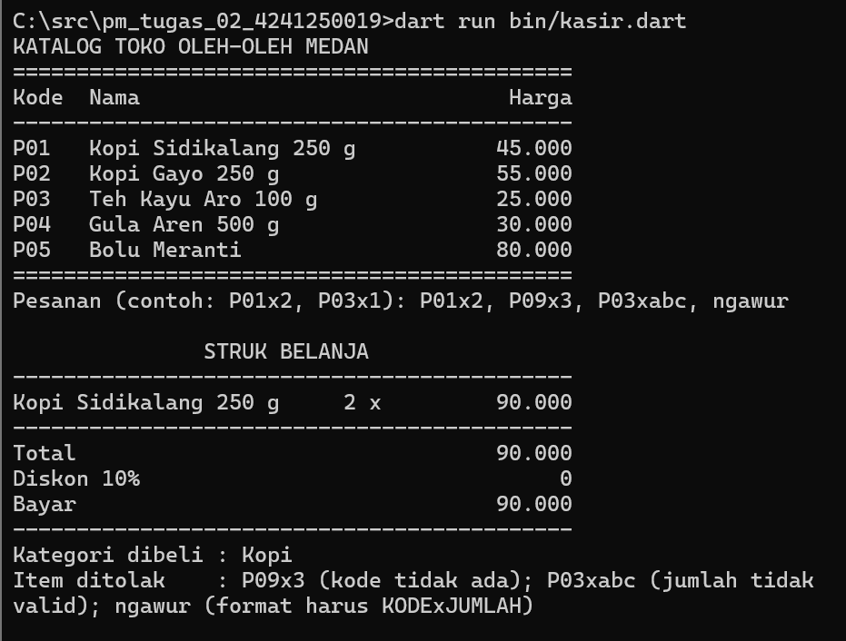

# Tugas Rutin 2 - Kasir Console Sederhana

**Nama:** Siti Haliza Zamili
**NIM:** 4241250019
**Kelas:** PSIK 24D

## Deskripsi
Program console Dart untuk toko oleh-oleh di Medan. Program menampilkan katalog, menerima pesanan dalam satu baris (contoh:`P01x2, P03x1`), lalu mencetak struk berisi total, diskon 10% (jika total >= Rp100.000), jumlah bayar, dan kategori produk yang dibeli. Kode yang salah dicatat sebagai item ditolak tanpa membuat
program crash.

## Cara Menjalankan
```
dart run bin/kasir.dart
```

## Tangkapan Layar

### Skenario 1: pesanan valid (`P01x2, P05x1`)


### Skenario 2: pesanan dengan kode salah (`P01x2, P09x3, P03xabc, ngawur`)


## Penjelasan
Dalam program ini saya memakai `final` untuk `katalog`, `input`, `total`, `diskon`, dan `bayar` karena nilainya hanya diisi sekali lalu tidak berubah. `var` dipakai untuk variabel yang nilainya boleh diganti setelah diisi, sedangkan `const` untuk nilai yang sudah pasti sebelum program berjalan, misalnya batas diskon 100000. Bedanya dengan `final`, `const` tidak bisa dipakai untuk `DateTime.now()` karena waktunya baru diketahui saat program berjalan.

Null safety mencegah crash pada baris `final produk = katalog[kode];` (baris [ISI NOMOR BARIS]) karena Map mengembalikan `Produk?`, yaitu `null` bila kode tidak ada. Hal serupa terjadi pada `int.tryParse(...)` (baris [ISI NOMOR BARIS]) yang bertipe `int?` bila teks bukan angka. Keduanya saya cek dengan `produk == null` dan `jumlah == null` (baris [ISI NOMOR BARIS]) sebelum dipakai, sehingga kode `P09` dan jumlah `abc` hanya dicatat sebagai item ditolak. Karena itu saya tidak memerlukan tanda `!`, dan program tetap berjalan sampai struk tercetak.

## Pernyataan Penggunaan AI
Saya menggunakan Claude (Anthropic) selama mengerjakan tugas ini.

**Dibantu AI:**
- Penjelasan materi Pertemuan 2 (modul dan slide).
- Kode `bin/kasir.dart`.
- Langkah Git dan kerangka README.
- Draf bagian Penjelasan (saya baca, pahami, dan sesuaikan).

**Saya kerjakan sendiri:**
- Membuat proyek, menjalankan program, dan menguji dua skenario.
- Mengambil tangkapan layar, menjalankan `dart format` dan `dart analyze`.
- Membuat repository GitHub, commit, dan push.